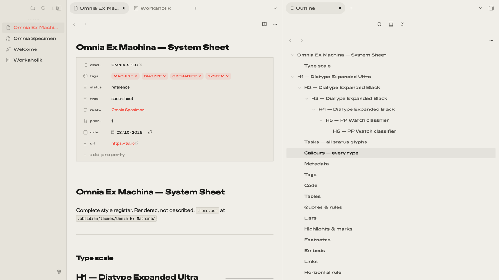
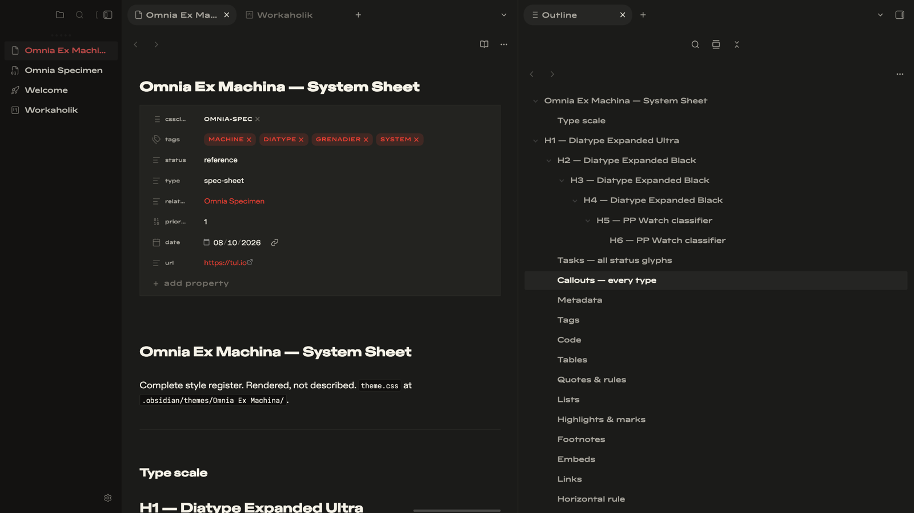
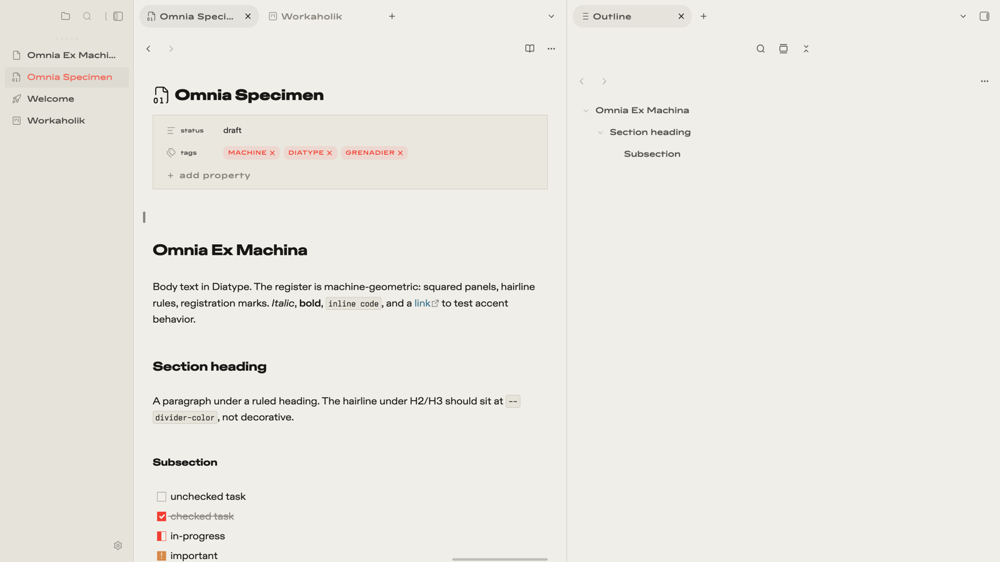

# Omnia Ex Machina

**Omnia Ex Machina** is a machine-geometric Obsidian theme inspired by Cupertino, featuring architectural typography, squared surfaces, precision hairline dividers, and a restrained visual language. Built around Paper & Ink light mode and Graphite & Phosphor dark mode, with customizable signal accents and carefully styled workspace components.

## Install

**Community themes** (once listed): Settings → Appearance → Themes → search "Omnia Ex Machina".

**Manual:** copy `theme.css` and `manifest.json` into `<vault>/.obsidian/themes/Omnia Ex Machina/`, then pick the theme in Settings → Appearance.

## Type system

No fonts ship with the theme — zero remote assets, fully self-contained. Stacks degrade to system faces:

| Role | Preferred | Fallback |
|---|---|---|
| Titles | ABC Diatype Expanded Ultra | SF Pro Display → Helvetica Neue |
| Headings | ABC Diatype Expanded Black | SF Pro Display → Helvetica Neue |
| Body | ABC Diatype Extended | SF Pro Text → Helvetica Neue |
| Interface & labels | PP Watch | condensed mono → Ioskeley Mono NF |
| Code | Ioskeley Mono | JetBrains Mono / SF Mono → Menlo |

- **ABC Diatype** (commercial): [abcdinamo.com](https://abcdinamo.com)
- **PP Watch** (commercial): [pangrampangram.com](https://pangrampangram.com)
- **Ioskeley Mono** (free): an Iosevka-built Berkeley-Mono-style variant — build via the [Iosevka customizer/docs](https://github.com/be5invis/Iosevka)

The theme reads any installed matching family names automatically; font names are also overridable per-role in Style Settings.

## Style Settings

38 settings in 5 groups (requires the [Style Settings](https://github.com/mgmeyers/obsidian-style-settings) plugin):

- **Typography** — per-role font-family overrides, measure
- **Surfaces** — radius, density, line width, machine tags, heading rules, Grenadier headings, Signal accent preset
- **Chrome & desktop** — titlebar, tabs, status bar treatments
- **Editor** — line numbers, guides, cursor, selection behavior
- **Accessibility** — contrast and motion accommodations

**Signal accent** re-maps the accent hue globally — links, tags, list markers, checkboxes, active states — in both themes: Grenadier (default), Cobalt, Amber, Viridian.

## Plugin integrations

Passive, class-scoped rules — applied only when the plugin is present, inert otherwise:

| Plugin | Integration |
|---|---|
| Iconic | `extras/iconic-preset.json` icon set (see below) |
| Calendar | machine register for the calendar pane |
| Dataview + cards helpers | squared tables, classify headers |
| Tasks | per-status accent checkboxes on squared boxes |
| Bases | hairline table chrome |
| Canvas | classify edge labels, squared nodes |
| Kanban | squared lanes/cards, classify lane titles, accent drag ring |
| Omnisearch | squared modal/results, classify metadata, accent highlight |
| Charts | squared canvas frame |
| Excalidraw | dark-scheme accent lift |

### Iconic preset

Copy `extras/iconic-preset.json` over `.obsidian/plugins/iconic/data.json` in your vault, then restart Obsidian.

## Mobile

Fully responsive: callouts, Kanban, and settings surfaces adapt under `is-mobile`; the iCloud-synced vault keeps desktop and phone on the same file. Density and radius sliders are the two knobs worth touching on small screens.

## Credits
 
Built on the [Cupertino](https://github.com/svnaxis/obsidian-cupertino) theme chassis by [Alexis C](https://github.com/svnaxis) (MIT License). Retains upstream structural foundation with custom typography, geometry, color palettes, and component styling.

## License

MIT — see [LICENSE](LICENSE).
